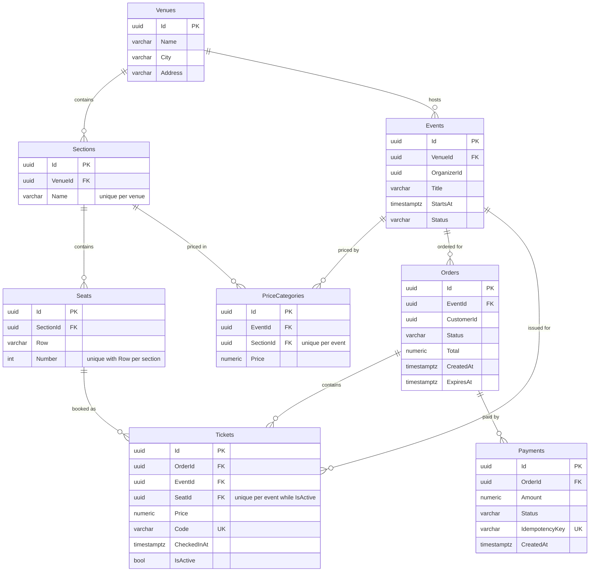

[](https://github.com/jagieldarek/seat-flow-app/actions/workflows/ci.yml)

Event ticketing API with seat reservations, built with .NET 11, EF Core and PostgreSQL. Work in progress.

## Database



Deleting cascades only inside a venue's layout (Venue → Section → Seat), from an event to its price categories and from an order to its tickets. Every other delete is restricted, so removing a venue, section, seat or event can never take orders, tickets or payments with it.

## Running locally

Requirements: .NET 11 SDK and Docker.

1. Copy `.env.example` to `.env` and set the passwords.
2. Start PostgreSQL (and pgAdmin on http://localhost:5050):
   ```
   docker compose up -d
   ```
3. Store the connection string in user secrets, using the values from `.env`:
   ```
   dotnet user-secrets set "ConnectionStrings:SeatFlow" "Host=localhost;Port=5432;Database=<POSTGRES_DB>;Username=<POSTGRES_USER>;Password=<POSTGRES_PASSWORD>" --project src/SeatFlow.Api
   ```
4. Create the database schema. In Development this also seeds demo data (one venue with 450 seats and two events):
   ```
   dotnet tool install --global dotnet-ef
   dotnet ef database update --project src/SeatFlow.Infrastructure --startup-project src/SeatFlow.Api
   ```
5. Run the API and check http://localhost:5217/health:
   ```
   dotnet run --project src/SeatFlow.Api
   ```

Tests: `dotnet test`
